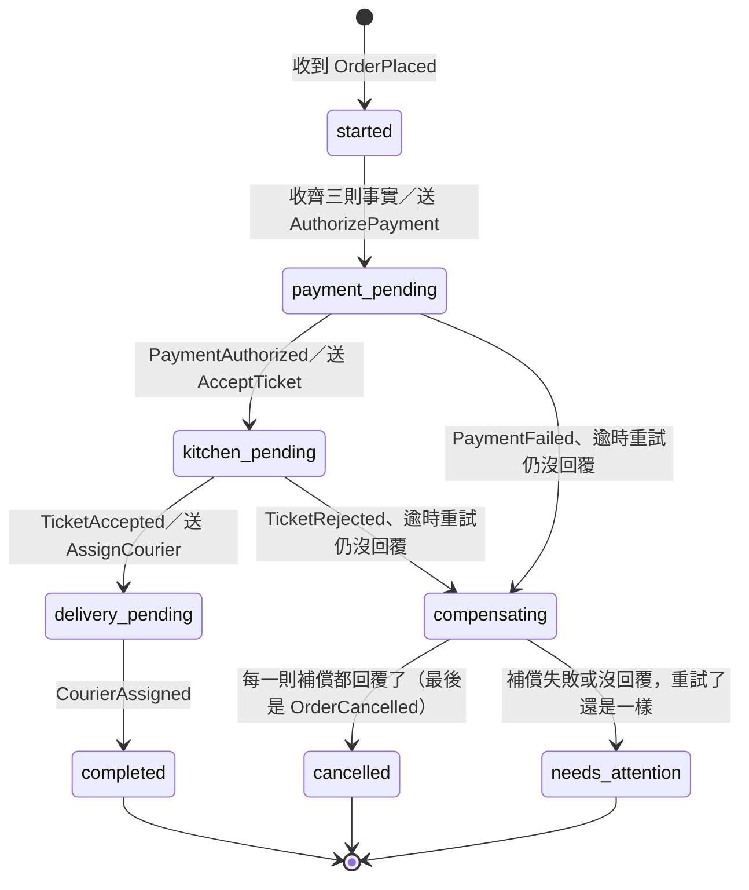

# FoodGo 通用語言

同一個字在同一個上下文裡只有一個意思。程式裡的名字和這張表一致。

## 同一張「訂單」，四個上下文各叫什麼

| 上下文 | 套件 | 名稱 | 在乎什麼 | 不在乎什麼 | 子領域 |
|---|---|---|---|---|---|
| 點餐 | `foodgo.ordering` | 訂單 Order | 品項、數量、總金額、訂單狀態 | 菜怎麼做、誰去送 | 核心 |
| 付款 | `foodgo.payment` | 付款 Payment | 金額、授權、退款 | 點了哪些菜 | 通用 |
| 廚房 | `foodgo.kitchen` | 廚房單 Ticket | 菜名、數量、備註、出餐時間 | 價格、顧客地址 | 支援 |
| 外送 | `foodgo.delivery` | 配送單 Delivery | 取餐點、送達點、外送員 | 菜名、價格 | 核心 |

跨上下文只用**編號**指向對方（例如 `order_id`），不直接拿對方的物件。

## Event Storming 時間軸（領域事件）

依發生順序。一律過去式：是已經發生、不能改的事實。

| 順序 | 事件 | 程式名稱 | 上下文 |
|---|---|---|---|
| 1 | 訂單已送出 | `OrderPlaced` | 點餐 |
| 2 | 付款已授權 | `PaymentAuthorized` | 付款 |
| 3 | 餐廳已接單 | `TicketAccepted` | 廚房 |
| 4 | 外送員已指派 | `CourierAssigned` | 外送 |
| 5 | 餐點已備妥 | `MealReady` | 廚房 |
| 6 | 餐點已取貨 | `MealPickedUp` | 外送 |
| 7 | 餐點已送達 | `MealDelivered` | 外送 |

出錯時的事件：

| 事件 | 程式名稱 | 上下文 |
|---|---|---|
| 付款已失敗 | `PaymentFailed` | 付款 |
| 餐廳已拒單 | `TicketRejected` | 廚房 |
| 付款已退款 | `PaymentRefunded` | 付款 |
| 訂單已取消 | `OrderCancelled` | 點餐 |

## 點餐模型（第 2 集：戰術設計）

| 詞 | 程式名稱 | 種類 | 意思 |
|---|---|---|---|
| 金額 | `Money` | 值物件 | 新臺幣整數元，不能是負數；數字一樣就是同一個值 |
| 送達地址 | `Address` | 值物件 | 地址一樣就是同一個地方；要改地址就換一個新的 |
| 品項 | `OrderLine` | 值物件 | 菜名、單價、數量（至少 1）；小計＝單價 × 數量 |
| 訂單 | `Order` | 實體、聚合根 | 靠訂單編號認人；品項、金額、狀態都只能透過它的方法改 |
| 外送費 | `Order.delivery_fee` | 金額 | 每張訂單一筆，算進合計 |
| 小計／合計 | `Order.subtotal`／`Order.total` | 金額 | 小計＝品項小計相加；合計＝小計＋外送費。A001：200＋30＝230 |
| 訂單狀態 | `OrderStatus` | 列舉 | 草稿 `draft` → 已送出 `placed` → 已取消 `cancelled` |
| 訂單 Repository | `OrderRepository` | 介面 | 用編號拿訂單、存訂單、發下一個編號（A001、A002…） |

### 訂單的不變條件

不管從哪裡呼叫（API、測試、之後的事件處理），下面這些永遠成立。違反時 `Order` 丟出 `OrderRuleViolation`，狀態不變、也不會記下事件。

1. 送出（`place()`）時至少要有一個品項，不能送出空訂單。
2. 送出後不能再改品項（`add_line()` 只在草稿時可用），也不能再送出一次。
3. 合計一定等於品項小計相加再加外送費，由訂單自己算，外面不能直接改。
4. 取消（`cancel()`）的規則：
   - 只有已送出的訂單可以取消；草稿還沒成立，不叫取消。
   - 已取消的訂單不能再取消：`OrderCancelled` 只會發生一次。
   - 取消一定要寫理由，理由會寫進 `OrderCancelled.reason`。
   - 取消後一樣不能改品項。

之後的集數加上新的狀態（例如餐點已取貨）時，取消的規則會再收緊，並寫回這張表。

### 聚合發出的領域事件

| 方法 | 成功後記下的事件 |
|---|---|
| `Order(...)` | `OrderDrafted`（訂單草稿已建立；第 6 集起） |
| `Order.add_line()` | `ItemAdded`（品項已加入；第 6 集起） |
| `Order.place()` | `OrderPlaced`（訂單已送出） |
| `Order.cancel(reason)` | `OrderCancelled`（訂單已取消） |

事件先記在訂單裡，存檔之後由外面呼叫 `pull_events()` 一次取走；取走後就清空，不會發兩次。

### HTTP 怎麼回

| 情況 | 狀態碼 |
|---|---|
| 送出成功 | 201 |
| 請求格式不對（例如數量 0、少欄位） | 422（FastAPI 自動檢查） |
| 送出時違反不變條件（例如空訂單） | 422（模型擋下，API 照實回報） |
| 對既有訂單做不允許的事（例如取消兩次） | 409 |
| 讀完到寫之間有人先改了這張訂單（`ConcurrencyConflict`，第 6 集） | 409 |
| 找不到訂單 | 404 |

## 事件驅動（第 3 集：從呼叫到通知）

### 命令與事件

| | 命令 Command | 事件 Event |
|---|---|---|
| 文法 | 祈使句：「開一張廚房單」`create_ticket()` | 過去式：「訂單已送出」`OrderPlaced` |
| 對象 | 指定一個接收者，發的人要認識它 | 不指定，0 到很多個訂閱者，發的人不用認識 |
| 能不能拒絕 | 可以：接收者可以丟例外、回錯誤 | 不能：事情已經發生了，只能決定自己要怎麼反應 |
| 發的人等不等 | 等結果，對方掛了自己也跟著失敗 | 不等，交出去就好 |

### 兩種事件

| | 領域事件 Domain Event | 整合事件 Integration Event |
|---|---|---|
| 放在哪 | `foodgo.<上下文>.events` | `foodgo.contracts`（共同語言） |
| 誰看得到 | 只有自己的上下文 | 任何訂閱的上下文 |
| 可以放什麼 | 內部的東西都可以（例如帶 `Money` 的品項） | 只放 JSON 認得的型別，只放下游需要的事實 |
| 能不能隨便改 | 可以，改了只影響自己 | 不行，有人照著讀；要守版本規則 |

點餐的 `OrderPlaced` 領域事件帶著含單價的品項；`foodgo.ordering.integration.to_integration()` 把它翻成 `contracts.OrderPlaced`，翻譯時把價格留在點餐裡。
廚房的 `MealReady` 領域事件（第 1 集）同理；廚房是支援子領域，模型簡單，這一集由 `Kitchen.mark_ready()` 直接公告 `contracts.MealReady`。

### 共同語言 Published Language（`foodgo.contracts`）

上下文之間只透過這裡的整合事件說話，彼此不 import。`foodgo.contracts` 只用標準函式庫，不認識任何上下文、共用核心或組裝點（第 4 條邊界規則）。
每份格式由發布的上下文維護：`contracts/ordering.py` 歸點餐、`contracts/kitchen.py` 歸廚房。

每一則整合事件都是同一種 JSON 信封：

```json
{
  "type": "OrderPlaced",
  "schema_version": 1,
  "event_id": "8b0e…",
  "occurred_at": "2026-11-06T02:15:08+00:00",
  "data": {"order_id": "A001", "restaurant_id": "R007",
           "items": [{"name": "牛肉麵", "quantity": 1}, {"name": "紅茶", "quantity": 1}],
           "note": "不要香菜"}
}
```

| 欄位 | 意思 |
|---|---|
| `type` | 事件名稱，過去式，和類別名稱一樣 |
| `schema_version` | `data` 的格式第幾版 |
| `event_id` | 這一則事件的編號（UUID 字串）；點餐翻譯時沿用領域事件的編號 |
| `occurred_at` | 事情發生的時間，ISO 8601、UTC |
| `data` | 事件本身的資料 |

### 整合事件放什麼、不放什麼

原則：只放訂閱者**現在**要用的事實。加欄位很容易，拿掉欄位很難——一旦發布，就有人照著讀。

| 事件 | 發布 | 訂閱 | 放 | 不放（為什麼） |
|---|---|---|---|---|
| `OrderPlaced` v1 | 點餐 | 廚房 | `order_id`、`restaurant_id`、`items`（菜名、份數）、`note` | 單價、外送費、合計：廚房不看價格。`customer_id`、送達地址：廚房用不到，個資能少傳就少傳 |
| `MealReady` v1 | 廚房 | （練習：外送） | `order_id`、`ticket_id`、`restaurant_id`（到哪裡取餐） | 菜名、備註：外送不在乎菜怎麼做 |
| `PaymentRequested` v1（第 7 集） | 點餐 | 付款 | `order_id`、`customer_id`（向誰收）、`amount`（合計，整數元） | 菜名：付款不在乎點了什麼。地址：付款用不到 |
| `DeliveryRequested` v1（第 7 集） | 點餐 | 外送 | `order_id`、`restaurant_id`（取餐點）、`delivery_address`（送達點） | 菜名、價格：外送不在乎 |
| `PaymentAuthorized` v1（第 7 集） | 付款 | 廚房 | `order_id`、`payment_id` | 金額：廚房不看價格；退款時付款自己查得到 |
| `PaymentFailed` v1（第 7 集） | 付款 | 廚房 | `order_id`、`payment_id`、`reason` | 卡號、金流服務的錯誤碼：留在付款的防腐層裡 |
| `TicketAccepted` v1（第 7 集） | 廚房 | 外送 | `order_id`、`ticket_id` | 菜名、備註 |
| `TicketRejected` v1（第 7 集） | 廚房 | （第 8 集：編排器） | `order_id`、`ticket_id`、`reason` | 菜名、備註 |
| `CourierAssigned` v1（第 7 集） | 外送 | （第 9 集：追蹤頁） | `order_id`、`delivery_id`、`courier_id` | 外送員的電話、位置：之後要再說 |
| `OrderCancelled` v1（第 8 集） | 點餐 | 編排器（第 9 集：追蹤頁） | `order_id`、`reason`（為什麼取消） | 品項、金額：要的人自己有 |
| `PaymentRefunded` v1（第 8 集） | 付款 | 編排器 | `order_id`、`payment_id`、`amount`（退了多少元；沒扣到款是 0） | 卡號、退款編號：留在付款的防腐層裡 |
| `RefundFailed` v1（第 8 集） | 付款 | 編排器 | `order_id`、`payment_id`、`reason` | 金流服務的錯誤碼 |
| `TicketCancelled` v1（第 8 集） | 廚房 | 編排器 | `order_id`、`ticket_id`、`reason` | 菜名、備註 |
| `SagaEscalated` v1（第 9 集） | 編排器（`saga.events`） | 追蹤頁（之後：客服） | `order_id`、`reason`（為什麼放棄） | saga 自己的帳（`done`、`todo`、`attempts`）：那是編排器內部的事 |

`OrderCancelled` 第 8 集起放進共同語言：編排器要知道「訂單取消了」才算補償做完，第 9 集的追蹤頁也要聽。付款要金額、外送要地址時也照同一條原則：第 7 集選了「另發事件」，理由見「付款要金額、外送要地址：放在哪」。

### 版本規則（`schema_version`）

1. **只加欄位**：不升版。舊的訂閱者略過不認得的欄位，照樣能讀（寬容讀取）。
2. **拿掉欄位、改名、改型別、改意思**：升 `schema_version`。訂閱者遇到不認得的版本就拒收，丟 `ValueError`，不會讀錯。
3. `type` 不對（拿 `OrderPlaced` 當 `MealReady` 讀）也一樣拒收。

### 事件匯流排 `EventBus`（`foodgo.shared.bus`）

| 詞 | 程式名稱 | 意思 |
|---|---|---|
| 發布 | `bus.publish(event)` | 把事件交給匯流排；發布者不知道、也不用知道誰在聽 |
| 訂閱 | `bus.subscribe(事件類別, 處理函式)` | 「這種事件發生時叫我」。訂閱關係寫在組裝點 `app.py` |
| 處理函式 | 例如 `Kitchen.on_order_placed` | 收到事件後做自己的事；名稱一律 `on_事件` |
| 沒送到的事件 | `bus.dead_letters`（`GET /bus/dead-letters`） | 處理函式丟例外時，事件、處理函式與錯誤記在這裡，不傳回發布者 |

匯流排先把事件轉成 JSON，再替每個訂閱者各還原一份：上下文之間只傳資料，不傳物件。

這一集的限制（第 4 集用 Kafka 解決）：

- 只在同一個程序裡：程式一關，沒處理完的事件就不見了。
- `dead_letters` 只是記下來，不會重試；廚房恢復後也不會補開那張廚房單。
- 訂閱者還是在下單的同一個請求裡執行：廚房慢，下單就跟著慢。

### 廚房單（第 3 集）

| 詞 | 程式名稱 | 種類 | 意思 |
|---|---|---|---|
| 廚房單 | `Ticket` | 實體 | 收到 `OrderPlaced` 就開一張，編號 T001、T002…；只記 `order_id`，不認識點餐的物件 |
| 菜 | `Dish` | 值物件 | 菜名與份數，沒有價格 |
| 廚房單狀態 | `TicketStatus` | 列舉 | 已收單 `received` → 餐點已備妥 `ready` |
| 出餐 | `Kitchen.mark_ready()`（`POST /tickets/{id}/ready`） | 方法 | 廚房單標成備妥，公告 `MealReady`；出過餐的不能再出一次（409） |
| 廚房當機 | `KitchenDown`（`FOODGO_FAULT_KITCHEN=crash`） | 故障注入 | 開廚房單時丟例外，用來示範「廚房掛了，下單照樣成功」 |

## 可靠地發與收（第 4 集：把事件交給 Kafka）

### Kafka 的詞

| 詞 | 意思 | FoodGo 裡 |
|---|---|---|
| broker | 存訊息、發訊息的 Kafka 伺服器 | 一台，KRaft 模式（自己兼 controller，不用 ZooKeeper） |
| topic | 一條有名字、只會往後加的訊息紀錄；讀了也不會刪 | `ordering.events`：點餐的整合事件都在這裡（`contracts.ORDERING_TOPIC`） |
| partition | topic 切成幾段，各自有順序；同一個 key 永遠進同一段 | 3 段；key＝`order_id`，同一張訂單的事件不會亂序 |
| offset | 訊息在 partition 裡的位置（0、1、2…） | 廚房讀到哪裡，就記到哪個 offset |
| consumer group | 一組一起讀同一個 topic 的程序，每段 partition 只交給組裡一個成員；讀到哪裡（offset）記在組的名字下 | `kitchen`；第 7 集付款、外送各自一組，互不影響 |
| 提交 commit | 告訴 Kafka「這一則我處理完了」 | 處理完才提交；當掉沒提交，重啟後同一則會再收到一次 |
| lag | 還沒處理的訊息數＝最新 offset − 已提交的 offset | Kafka UI 的 Consumers 頁；廚房停掉時會變大，重啟後回到 0 |

### 雙寫問題

「先寫資料庫、再送 Kafka」是兩個系統、兩次寫入，中間沒有交易包住：

| 順序 | 中間當掉會怎樣 |
|---|---|
| 先 commit 訂單，再送事件 | 訂單成立了，事件沒送出去：廚房永遠不知道（掉事件） |
| 先送事件，再 commit 訂單 | 廚房開了單，訂單卻沒存成功（幽靈事件） |

### Transactional Outbox

| 詞 | 程式名稱 | 意思 |
|---|---|---|
| outbox | `outbox` 表（`foodgo.infra.outbox`） | 要發的事件先寫進點餐自己的資料庫，**和訂單同一個交易**：要嘛都成功、要嘛都沒發生 |
| 存訂單 | `PostgresOrderRepository.save()` | 一個交易裡：寫 `orders`，再把 `pull_events()` 翻成整合事件寫進 `outbox`；`OrderCancelled` 不公告，不寫 |
| relay | `python -m foodgo.ordering.relay`（`outbox.relay_once()`） | 另一個程序：把 `sent_at IS NULL` 的列照順序送到 Kafka，Kafka 確認收到才標記 `sent_at` |
| 重送 | `FOODGO_FAULT_RELAY=crash-after-send` | relay 送出後、標記前當掉：重啟會再送一次，Kafka 上出現同一則的兩份 |

訊息格式：key＝`order_id`；value＝第 3 集的 JSON 信封（`to_json()`，原封不動）；header 帶 `event_id`、`type`（方便在 Kafka UI 上看）。

### 至少一次送達＋冪等消費者

- **至少一次（at-least-once）**：relay 和 consumer 都是「做完才記帳」，中間當掉就重做。不會掉，但可能重複。
- **冪等（idempotent）**：同一則訊息處理一次和處理兩次，結果一樣。重複交給消費者自己擋。
- 廚房用 `event_id` 判重：`processed_messages`（`consumer`、`event_id` 是主鍵）。開廚房單和記下「這則處理過了」寫在**同一個交易**（`PostgresTicketRepository.add()`），重送幾次都只開一張。

| 詞 | 程式名稱 | 意思 |
|---|---|---|
| 廚房 consumer | `python -m foodgo.kitchen.consumer`（consumer group `kitchen`） | 讀 `ordering.events`，收到 `OrderPlaced` 開廚房單；其他事件略過 |
| 處理過的訊息 | `processed_messages`（`foodgo.infra.inbox`） | 冪等消費者的帳本：哪個 consumer 處理過哪一則 `event_id` |
| 處理過了 | `Kitchen.on_order_placed()` | 這則 `event_id` 記過了，就印「處理過了」、不再開單 |
| 廚房當機 | `FOODGO_FAULT_KITCHEN=crash` | consumer 收到就當掉、不提交；訊息留在 Kafka，修好重啟會補開那張單 |

第 3 集匯流排的三個限制，這一集的答案：

- 程序一關事件就不見 → 事件先在 PostgreSQL 的 outbox，再到 Kafka，兩邊都存在硬碟上。
- 不會重試 → consumer 沒提交就會再收到；relay 沒標記就會再送。
- 廚房慢下單也慢 → API 只寫資料庫；relay、廚房 consumer 是另外的程序。

## 事件溯源（第 5 集：狀態是事件的總和）

### CRUD 只留結果，事件留下過程

| | CRUD（第 2～4 集的 `orders` 表） | 事件溯源 Event Sourcing |
|---|---|---|
| 存什麼 | 現在長怎樣：一張訂單一列，每次 `UPDATE` 蓋掉舊的 | 發生過哪些事：一張訂單一串事件，只往後加 |
| A001 留下 | 最後一列：`cancelled`、兩個品項、`updated_at` 是取消的時間 | 5 個事件：建立草稿、加牛肉麵、加紅茶、送出、取消（含理由） |
| 現在的狀態 | 直接讀那一列 | 用算的：`state = fold(events)` |
| 過去某一刻 | 不知道，除非另外寫歷史表 | 只套前面幾個事件：`fold(events[:4])` 就是送出那一刻 |
| 改錯了 | 舊值被蓋掉就沒了 | 不改舊事件，再加一個新事件更正 |

第 4 集的 `orders` 表沒有放取消理由的欄位，`OrderCancelled` 也不進 outbox：在 CRUD 的世界裡，「顧客改變心意」這句話存檔後就不見了。

### 點餐的事件流

Order 的每個動作對應一個事件，照順序套上去就能算回整張訂單（第 6 集起由 `Order` 的方法發出，這一集先手寫）：

| 順序 | 事件 | 程式名稱 | 對應的動作 | 帶什麼 | `evolve` 怎麼改狀態 |
|---|---|---|---|---|---|
| 1 | 訂單草稿已建立 | `OrderDrafted` | `Order(...)` | 訂單編號、顧客、餐廳、送達地址、外送費、備註 | 從無到有：`draft`、還沒有品項 |
| 2… | 品項已加入 | `ItemAdded` | `add_line()` | 菜名、單價、數量 | 品項接在後面 |
| | 訂單已送出 | `OrderPlaced` | `place()` | （第 1 集就有） | `placed`；品項以 `ItemAdded` 為準，`OrderPlaced.lines` 是給廚房的快照 |
| | 訂單已取消 | `OrderCancelled` | `cancel(reason)` | 理由 | `cancelled` |

`OrderDrafted`、`ItemAdded` 是點餐自己的領域事件，不進 Event Storming 的 11 張便利貼、也不對外公告（`to_integration()` 回 `None`，不寫進 outbox）。

### 詞

| 詞 | 程式名稱 | 意思 |
|---|---|---|
| 事件溯源 | Event Sourcing | 只存事件，狀態用事件算出來 |
| 狀態 | `OrderState`（`foodgo.ordering.fold`） | 某一刻的訂單；frozen dataclass，算出來就不能改 |
| 演進 | `evolve(state, event) -> state` | 套上一個事件、回傳新的狀態。純函式：不碰資料庫、不看時鐘、不改舊狀態；不檢查業務規則（事件是已經發生的事實） |
| 摺疊 | `fold(events) -> state` | 從第一個事件套到最後一個（`reduce(evolve, events, None)`）；沒有事件回 `None`；認不得的事件丟 `TypeError`，不默默略過 |
| 事件流 stream | `stream_id`（訂單編號，例如 `A001`） | 同一張訂單的所有事件，照發生順序排好 |
| 版本 version | `OrderState.version`、`RecordedEvent.version` | 這條流的第幾個事件，從 1 開始；狀態的版本＝已經套用了幾個事件；還沒有事件的流是第 0 版 |
| 事件儲存 | `InMemoryEventStore`（`foodgo.shared.event_store`） | 只能 `append`、`load`，沒有改、沒有刪；第 6 集換成 PostgreSQL 的 `events` 表 |
| 一列事件 | `RecordedEvent` | `stream_id`、`version`、`type`、`occurred_at`、事件本身；`(stream_id, version)` 不會重複 |
| 預期版本 | `append(stream_id, events, expected_version=…)` | 「我讀到的是第幾版」；新的流是 0 |
| 樂觀併發 | `ConcurrencyConflict` | 先不鎖，寫的時候才比對版本：對不上就是有人先寫了，整批不寫。重讀、用新的狀態重新判斷規則，再決定要不要寫 |

為什麼要樂觀併發：顧客 App 和客服後台同時讀到第 4 版（`placed`），都覺得可以取消。沒有 `expected_version` 的話兩個 `OrderCancelled` 都會寫進去——「已取消不能再取消」就被繞過了。有了它，第二個人會拿到 `ConcurrencyConflict`，重讀後看到 `cancelled`，`Order` 的規則就擋下來。

### 什麼時候不該用事件溯源

事件溯源的代價：要多寫事件與 `evolve`、事件格式一旦存下去就要一直讀得懂（升版、轉換）、查詢要另外做讀模型（第 9 集）、「改錯資料」不能直接 `UPDATE`。值得付這個代價的，是**過程本身有意義**的東西。

| FoodGo 裡的東西 | 用什麼 | 為什麼 |
|---|---|---|
| 訂單（點餐） | 事件溯源（第 6 集） | 流程長、狀態多、會被併發修改；「什麼時候送出、為什麼取消」客服與對帳都要查；後面的 Saga、追蹤頁都靠這串事件 |
| 菜單、菜價 | CRUD | 店家改價格就是改價格，沒人問「上週二下午這道菜的說明改過幾次」；訂單需要的價格已經寫在 `ItemAdded.unit_price` 裡 |
| 餐廳資料（店名、地址、營業時間） | CRUD | 就是一張資料表；要留修改紀錄的話，加一張稽核表就夠了 |
| 顧客的帳號資料 | CRUD | 個資要能真的改、真的刪；事件只能往後加，刪不掉 |
| 廚房單 | CRUD（第 4 集的 `tickets`） | 支援子領域，狀態只有收單 → 備妥；它要的過程已經在 Kafka 的事件裡 |
| 報表、看板 | 讀模型（第 9 集） | 從事件投影出來的表，壞了就砍掉重建 |

判斷的問題：要不要回答「當時是什麼樣子、怎麼變成這樣」？會不會有人同時改同一筆？事件本身是不是業務上的事實？三個都是「否」，CRUD 就好。

## 事件溯源上 PostgreSQL（第 6 集：重播、快照、時光機）

### 存的地方：`events` 表與 `snapshots` 表

| 欄位 | 意思 |
|---|---|
| `position` | `bigserial`：所有事件流排在同一條線上的第幾個（第 9 集的投影改從 Kafka 讀，沒有用它：見「讀模型從哪裡重建」） |
| `stream_id`、`version` | 哪一條事件流（訂單編號）、第幾個事件；`UNIQUE (stream_id, version)`：同一條流不會有兩個第 5 版 |
| `event_id` | 事件自己的編號（`UNIQUE`）；整合事件沿用它，廚房用它判重 |
| `type`、`data` | 事件名稱與內容（`jsonb`）。基礎設施只認這兩個，不認識事件類別 |
| `occurred_at` | 事件發生的時間：時光機照這個查 |

`events` 表**只能往後加**：`UPDATE`、`DELETE`、`TRUNCATE` 都由資料庫的觸發器擋下來（「事件只能往後加，不能改、不能刪」）。寫錯了就再加一個更正的事件。

`snapshots` 表（`stream_id`、`version`、`state jsonb`）放某一版的狀態。快照只是捷徑：刪掉了照樣能從事件算回來；`OrderState` 改了欄位，舊快照刪掉重建就好，事件才是真相。

### 誰負責什麼

| 層 | 程式 | 做什麼 |
|---|---|---|
| 基礎設施 | `foodgo.infra.event_store` | SQL：`append`（比對版本、寫入）、`read`（照版本讀，可以接在快照後面、可以只讀某個時間以前）、`save_snapshot`、`latest_snapshot`。只認 type＋data，版本對不上丟自己的 `VersionConflict` |
| 點餐 | `foodgo.ordering.codec` | 事件 ↔ `(type, data)`、狀態 ↔ 快照 JSON：`Money` 攤成整數元、`Address` 攤成字串。純函式；認不得的 type 丟 `TypeError` |
| 點餐 | `PostgresEventStore`（`foodgo.ordering.event_sourcing`） | 第 5 集 `InMemoryEventStore` 的 PostgreSQL 版，介面一樣；把 `VersionConflict` 翻成第 5 集的 `ConcurrencyConflict` |
| 點餐 | `EventSourcedOrderRepository` | 第 2 集的 `OrderRepository`（`next_id`／`get`／`save`），存的是事件；多了 `load`、`take_snapshot`、`load_as_of`、`history` |

第 5 條邊界規則「基礎設施不認識任何上下文」照樣守著；第 6 條「點餐的領域模型不碰基礎設施」：`model`、`events`、`fold`、`codec` 不能 import `foodgo.infra`、`foodgo.contracts`。

### 詞

| 詞 | 程式名稱 | 意思 |
|---|---|---|
| 重播 replay | `fold(store.load("A001"))` | 照版本順序讀出一條流的事件，一個一個 `evolve` 回現在的狀態 |
| 從狀態擺回聚合 | `Order.from_state(state)` | 取代第 4 集的 `Order.restore()`：Repository 先 `fold` 出 `OrderState`，再擺回 `Order`；不檢查規則、不記事件 |
| 訂單的版本 | `Order.version` | 套用了幾個事件（含還沒存的）。存的時候 `expected_version = 版本 − 還沒存的事件數` |
| 存訂單 | `EventSourcedOrderRepository.save(order)` | 一個交易：新事件 `append` 到 `events`，要公告的（`OrderPlaced`）寫進 `outbox`。一起成功、一起失敗 |
| 併發衝突 | `ConcurrencyConflict` → HTTP 409 | 讀完到寫之間有人先寫了。兩個連線同時寫第 5 版時，後寫的那個會在 `UNIQUE` 索引上等先寫的交易結束，再被擋下。API 回 409，請呼叫的人重新讀取、再決定（不自動重試：重讀之後規則可能已經不讓你做了） |
| 快照 snapshot | `take_snapshot(order_id)`、`load(order_id)` | 把某一版的狀態存起來；載入時從最新的快照接著 `fold(後面的事件, 快照)`。`Loaded.events_read` 看得到讀了幾個事件 |
| 時光機 | `load_as_of(order_id, when)`、`GET /orders/{id}?as_of=…` | 只 `fold` 那個時間點以前發生的事件（`occurred_at <= when`）。時間要帶時區；API 沒寫時區就當臺北時間。時光機不用快照，一律從頭算 |
| 事件歷史 | `history(order_id)`、`GET /orders/{id}/events` | 一張訂單的每一個事件：版本、名稱、時間、內容 |

記憶體版的 `InMemoryOrderRepository` 只記現在的樣子：`as_of` 與 `/events` 回 501。

## 跨服務的交易（第 7 集：Saga 與編舞式）

### 為什麼不用 2PC

「下單、扣款、廚房接單、派外送員」要嘛全部成功、要嘛全部不算。單一資料庫用一個交易就好；跨了四個上下文，直覺的做法是**兩階段提交（2PC，Two-Phase Commit）**：

| | 2PC：一個協調者、所有人一起提交 | Saga：一串本地交易＋補償 |
|---|---|---|
| 怎麼做 | 協調者先問每個參與者「準備好了嗎」（prepare），全部說好才叫大家「提交」（commit） | 每一步在自己的資料庫 commit、公告事件；後面失敗了，前面做過的用**補償**反著做一次 |
| 等的時候 | 每個參與者 prepare 之後鎖著資料，等協調者的下一句話 | 不等：做完就放手 |
| 協調者當掉 | 大家卡在「準備好了」：不能提交、也不敢放棄（阻塞） | 沒有協調者（編舞式），或協調者把進度存在資料庫、重啟後接著做（第 8 集） |
| 誰要支援 | 每個參與者都要支援同一種協定（XA）。Kafka、外面的金流服務都不會陪你 prepare | 只要會做本地交易、會發事件 |
| 可用性 | 四個服務**同時**都活著才下得了單 | 誰慢了、掛了，訊息留在 Kafka，等它回來接著做 |
| 中間看得到嗎 | 看不到：要嘛都有、要嘛都沒有 | 看得到：付款成功、廚房還沒接單的那一刻是真的存在的（最終一致） |

### 詞

| 詞 | 程式／例子 | 意思 |
|---|---|---|
| Saga | 這一集的接力；第 8 集的 `OrderSaga` | 一個跨上下文的流程，拆成一串**本地交易**，每一步都有對應的**補償** |
| 本地交易 | 付款：`payments`＋`payment_outbox`＋`processed_messages` 一起 commit | 一個上下文、一個資料庫裡的交易。跨上下文只靠事件，沒有共同的交易 |
| 補償 compensation | 退款 `PaymentRefunded`、取消訂單 `OrderCancelled` | 已經 commit 的事不能 rollback，只能再做一件**新的事**把它抵銷。補償本身也是本地交易、也可能失敗（第 8 集） |
| 編舞式 choreography | 這一集 | 沒有指揮：每個參與者聽別人的事件、做自己的事、公告結果。流程藏在「誰訂閱誰」裡 |
| 編排式 orchestration | 第 8 集 | 一個編排器記住流程走到哪，送命令給每個參與者、收回覆；失敗時由它決定補償 |
| 防腐層 ACL（Anti-Corruption Layer） | `foodgo.payment.gateway` | 外面系統的說法（欄位、單位、錯誤碼）在這裡翻成自己的話，不讓它滲進模型（第 1 集講過的概念） |
| 誰先到不一定 | `kitchen_payments`、`delivery_tickets` | Kafka 只保證**同一個 partition** 裡的順序；不同 topic 之間沒有先後。聽兩個 topic 的人，要先把聽到的記下來，等兩邊都到了才往下走 |

### A001 的接力

| 棒 | 誰 | 聽到 | 本地交易做什麼 | 公告 | topic |
|---|---|---|---|---|---|
| 1 | 點餐（API） | `POST /orders` | `events` 4 列＋`outbox` 3 列 | `OrderPlaced`、`PaymentRequested`、`DeliveryRequested` | `ordering.events` |
| 2 | 付款 | `PaymentRequested` | 向金流服務要授權；`payments` 一列（P001、230 元） | `PaymentAuthorized`（失敗：`PaymentFailed`） | `payment.events` |
| 3 | 廚房 | `OrderPlaced` | 開廚房單 T001：`received`（等付款） | — | |
| 4 | 廚房 | `PaymentAuthorized` | T001 → `accepted`（`FOODGO_FAULT_KITCHEN=reject`：`rejected`） | `TicketAccepted`（拒單：`TicketRejected`） | `kitchen.events` |
| 5 | 外送 | `DeliveryRequested` | 開配送單 D001：`waiting`（等餐廳接單） | — | |
| 6 | 外送 | `TicketAccepted` | D001 → `assigned`，外送員 M01 | `CourierAssigned` | `delivery.events` |

3 和 5 可能比 2、4 先發生，也可能晚發生：廚房與外送各聽兩個 topic，先到的先記下來。

### 誰聽什麼、存哪裡

| 上下文 | 程序 | consumer group | 聽 | 發（自己的 outbox → topic） | 自己的表 |
|---|---|---|---|---|---|
| 點餐 | `fastapi dev`＋`python -m foodgo.ordering.relay` | — | — | `outbox` → `ordering.events` | `events`、`snapshots`、`outbox` |
| 付款 | `python -m foodgo.payment.consumer` | `payment` | `ordering.events` | `payment_outbox` → `payment.events` | `payments`、`payment_outbox` |
| 廚房 | `python -m foodgo.kitchen.consumer` | `kitchen` | `ordering.events`、`payment.events` | `kitchen_outbox` → `kitchen.events` | `tickets`、`kitchen_payments`、`kitchen_outbox` |
| 外送 | `python -m foodgo.delivery.consumer` | `delivery` | `ordering.events`、`kitchen.events` | `delivery_outbox` → `delivery.events` | `deliveries`、`delivery_tickets`、`delivery_outbox` |

- 每個 consumer 都讀**整個** topic，只挑自己要的 `type`，其他的略過（付款 consumer 也會收到 `OrderPlaced`，印一行「收到」就沒事了）。
- 冪等照第 4 集：`processed_messages`（`consumer`＋`event_id`），和業務資料寫在同一個交易。「記下聽到的」只做一次；「要不要往下走」看目前的狀態決定，重做幾次結果都一樣。
- 要公告的事件和業務資料寫在同一個交易（自己的 outbox），consumer 每處理完一則、每閒下來一秒，就把自己 outbox 裡還沒送的送出去：沒有雙寫問題，也不用再多開 relay 程序。
- 現在四個上下文的表在同一個資料庫，但**沒有一張表被兩個上下文讀寫**：第 10 集拆成四個資料庫時，一行 SQL 都不用改。`processed_messages` 是共用的帳本格式，用 `consumer` 欄位分開。

| 廚房單狀態（第 7 集起） | 意思 |
|---|---|
| `received` | 已收單：等付款的結果 |
| `accepted` | 餐廳已接單（`TicketAccepted`） |
| `rejected` | 餐廳已拒單（`TicketRejected`） |
| `cancelled` | 不做了：付款失敗。廚房自己決定的，沒有公告 |
| `ready` | 餐點已備妥（`MealReady`，第 3 集）。拒單、不做了的單不能出餐 |

| 配送單 | 程式名稱 | 意思 |
|---|---|---|
| 配送單 | `Delivery`（D001…） | 取餐點（餐廳編號）、送達點（地址）、外送員 |
| 配送單狀態 | `DeliveryStatus` | 等餐廳接單 `waiting` → 外送員已指派 `assigned` |
| 派車台 | `Dispatch` | 外送的應用服務：開配送單、餐廳接單後輪流指派外送員（M01、M02、M03） |

### 付款要金額、外送要地址：放在哪

第 3 集的 `OrderPlaced` 只給廚房，刻意不帶價格與地址。第 7 集付款要金額、外送要地址，兩個選擇：

| | A. `OrderPlaced` 加欄位（`customer_id`、`amount`、`delivery_address`） | B. 另發事件（**選這個**） |
|---|---|---|
| 版本規則 | 只加欄位，不升版；廚房寬容讀取，略過不認得的欄位 | `OrderPlaced` 一個字都沒改；新事件 `PaymentRequested`、`DeliveryRequested` 都是第 1 版 |
| 誰收到什麼 | 聽 `OrderPlaced` 的人全部收到價格、顧客編號、地址——廚房也是 | 付款只拿到金額與顧客，外送只拿到取餐點與地址，廚房照舊 |
| 之後要改 | 欄位一旦發布就有人照著讀，想再拿掉很難 | 哪一則不需要了，整則停發就好；不影響別人 |
| 代價 | 一則訊息 | 一次下單三則（同一個交易寫進 outbox、同一個 key，所以順序不會亂） |

選 B 的理由：第 3 集的原則「只放訂閱者**現在**要用的事實」「廚房不看價格」「個資能少傳就少傳」，A 三條都違反。

B 的老實話：

- `PaymentRequested`、`DeliveryRequested` 名字像命令——點餐其實已經知道「下一步是付款、外送」。這種「指名給某個人看的事件」正是編舞式往編排式移動的徵兆，第 8 集改成真的命令。
- 同一個 topic 的訊息，廚房 consumer 照樣讀得到 bytes，只是不解析。真的要把個資擋在外面，要分 topic 或加密，這門課不做。

### 流程走到哪？

編舞式裡**沒有一個地方**記著 A001 走到哪。要回答「A001 現在怎樣了」，得自己拼：

| 去哪裡查 | 查到什麼 |
|---|---|
| 點餐的 `events` | 第 4 版 `placed`（點餐不知道後面發生了什麼） |
| 付款的 `payments` | P001 `authorized` 230 元 |
| 廚房的 `tickets`（＋`kitchen_payments`） | T001 `accepted` |
| 外送的 `deliveries`（＋`delivery_tickets`） | D001 `assigned`，外送員 M01 |
| 4 個 topic（key＝A001） | 6 則訊息，照時間排起來才看得出先後 |
| 3 個 consumer group 的 lag | 有沒有人還沒處理完 |

示範腳本把這些拼在一起：`uv run python demos/ep07_choreography.py trace A001`。第 8 集的編排器把進度存在一張 saga 表；第 9 集從事件投影出「訂單追蹤」讀模型——都是在回答這個問題。

### 付款失敗的那一條：編舞式的難處

`FOODGO_FAULT_PAYMENT=decline`（假的金流服務每一筆都拒絕）時，A002 停在半路：

| 上下文 | 知道付款失敗了嗎 | 現在 |
|---|---|---|
| 點餐 | 不知道：沒有聽 `payment.events` | `placed`：顧客看到的還是「已送出」 |
| 付款 | 知道 | P002 `failed`（卡片額度不足） |
| 廚房 | 知道：聽 `payment.events` | T002 `cancelled`：自己不做了，沒有公告 |
| 外送 | 不知道 | D002 `waiting`：等一張永遠不會來的 `TicketAccepted` |

誰該取消訂單、告訴顧客、收掉配送單？讓點餐也聽 `payment.events`？那廚房拒單時誰退款——付款也去聽 `kitchen.events`？外送找不到人時呢？每多一種失敗，就多幾條訂閱線，流程散在每個人的程式裡。第 8 集改用編排式：一個編排器負責整條流程與補償。

### 故障開關（第 7 集）

| 環境變數 | 加在哪個程序 | 會怎樣 |
|---|---|---|
| `FOODGO_FAULT_PAYMENT=decline` | 付款 consumer | 假的金流服務每一筆都拒絕 → `PaymentFailed` |
| `FOODGO_FAULT_KITCHEN=reject` | 廚房 consumer | 付款過了也拒單 → `TicketRejected`（第 8 集示範補償用） |
| `FOODGO_FAULT_KITCHEN=crash` | 廚房 consumer | 第 4 集那一個：收到 `OrderPlaced` 就當掉 |

### 防腐層：付款和金流服務各說各的

| 付款說的（`foodgo.payment.gateway`） | 金流服務說的（`foodgo.payment.fakepay`，假的） |
|---|---|
| `authorize("A001", 230)`：新臺幣整數元 | `{"merchant_order_no": "A001", "amount_minor": 23000, "currency": "TWD"}`：單位是「分」 |
| `Authorization(approved=True, reference="AUTH-0001")` | `{"result": "APPROVED", "auth_code": "AUTH-0001", …}` |
| `Authorization(approved=False, reason="卡片額度不足")` | `{"result": "DECLINED", "decline_code": "insufficient_funds", …}` |

- 付款的模型與服務只認 `CardGateway` 介面；翻譯全在 `FakePayAdapter`。換一家金流服務，只換 adapter。
- 第 7 條邊界規則「付款只透過防腐層找金流服務」：`payment.payment／repository／postgres／service／consumer` 直接 import `payment.fakepay` 會被擋（經過 `gateway` 間接用到可以）。
- 訂單編號當**冪等鍵**（`merchant_order_no`）：付款 consumer 授權完、還沒 commit 就當掉，重送時金流服務回上一次的答案，不會刷兩次卡。

## 出錯時怎麼倒回去（第 8 集：編排式 Saga 與補償）

### 為什麼換成編排式

第 7 集的編舞式，失敗分支沒有人負責：付款失敗時點餐不知道、拒單時沒有人退款。要補上，只能每個人再多聽幾條線，流程散在四個 consumer 裡。編排式把流程收回一個地方：

| | 編舞式（第 7 集） | 編排式（第 8 集） |
|---|---|---|
| 誰決定下一步 | 每個參與者自己：聽到誰的事件就做 | 編排器 `OrderSaga`：收到回覆，決定下一個命令 |
| 參與者聽什麼 | 別人的事件（`ordering.events`、`payment.events`…），常常要聽兩條 | 只聽給自己的**命令 topic**（`payment.commands`…） |
| 流程寫在哪 | 散在「誰訂閱誰」裡 | 一張狀態機（`foodgo/saga/machine.py`） |
| 走到哪了 | 拼 4 張表、4 個 topic | 查 `sagas` 一列；怎麼走過來的，看 `saga_log` |
| 失敗時 | 誰該補償要大家說好 | 編排器照「做成的步驟」倒著送補償命令 |
| 代價 | 少一個元件 | 多一個要顧好的元件（它掛了流程就停；狀態存在資料庫，重啟後接著做） |

`FOODGO_SAGA` 切換兩種接法（只影響付款、廚房、外送的 consumer 聽哪些 topic）：

| `FOODGO_SAGA` | 付款聽 | 廚房聽 | 外送聽 | 要不要開編排器 |
|---|---|---|---|---|
| `orchestration`（預設） | `payment.commands` | `kitchen.commands` | `delivery.commands` | 要：`python -m foodgo.saga.consumer`＋`python -m foodgo.ordering.consumer` |
| `choreography`（第 7 集） | `ordering.events` | `ordering.events`、`payment.events` | `ordering.events`、`kitchen.events` | 不用 |

同一個 Kafka、同一個資料庫不要兩種接法混著跑（consumer group 名稱一樣，換接法會從頭讀另一條 topic）：要換先 `docker compose down -v`。

### 詞

| 詞 | 程式／例子 | 意思 |
|---|---|---|
| 編排器 orchestrator | `foodgo.saga`：`Orchestrator`＋`OrderSaga` | 記住每張訂單走到哪、送命令、收回覆、失敗時決定補償。只說共同語言 |
| `OrderSaga` | 一張訂單一個，`saga_id`＝`order_id` | 狀態機：狀態、正在等哪個回覆、做成了哪幾步、還要補償哪幾步 |
| 命令 command | `contracts.Command`：`AuthorizePayment`、`RefundPayment`… | 祈使句、指名一個接收者（`receiver`）。接收者可以說不：回一則失敗的事件（第 3 集的命令 vs 事件） |
| 命令 topic | `<接收者>.commands`，例如 `payment.commands` | 一個參與者一條，名字跟著**收的人**；命令的格式也歸收的人維護（它說它接受什麼）。事件 topic 跟著**發的人**：`<發布者>.events` |
| 回覆 reply | `PaymentAuthorized`、`TicketRejected`… | 參與者做完公告在自己的事件 topic：還是過去式的事件。編排器聽四條事件 topic，照 `order_id` 交給對的 saga |
| 補償 compensation | `RefundPayment`、`CancelTicket`、`CancelOrder` | 做成的步驟倒著抵銷（後做的先補）。補償也是命令，也要等回覆、也可能失敗 |
| 逾時 timeout | `FOODGO_SAGA_TIMEOUT`（預設 3 秒） | 送出命令就開始計時：`sagas.deadline`。編排器每處理完一則、每閒一秒看一次 |
| 重試 retry | `FOODGO_SAGA_RETRIES`（預設 1 次） | 逾時、或退款失敗：同一個命令再送一次（新的編號）。參與者照訂單編號認，重做不會做兩次，只是再回一次 |
| 結果不確定 | 逾時放棄的那一步 | 對方也許做了、只是很慢。它的補償照送、但不等回覆：命令 topic 照順序，補償一定排在原本的命令後面 |
| 人工處理 `needs_attention` | 退款重試了還是失敗 | 補償不能默默放棄：saga 停在這裡，`saga_log` 寫清楚卡在哪，等人來處理 |
| `saga_log` | 每一列：`state`、`action`、`message`、`detail` | saga 的日記：收到什麼、送了什麼、逾時、重試、補償、放棄。只往後加 |

### 命令與回覆

| 命令（祈使句） | 誰送 → 誰收 | 命令 topic | 帶什麼 | 回覆（成功／失敗） |
|---|---|---|---|---|
| `AuthorizePayment` 授權付款 | 編排器 → 付款 | `payment.commands` | `order_id`、`customer_id`、`amount` | `PaymentAuthorized`／`PaymentFailed` |
| `AcceptTicket` 接單 | 編排器 → 廚房 | `kitchen.commands` | `order_id`、`restaurant_id`、`items`、`note`（沒有價格） | `TicketAccepted`／`TicketRejected` |
| `AssignCourier` 指派外送員 | 編排器 → 外送 | `delivery.commands` | `order_id`、`restaurant_id`（取餐點）、`delivery_address` | `CourierAssigned` |
| `RefundPayment` 退款（補償） | 編排器 → 付款 | `payment.commands` | `order_id`、`reason`（不帶金額：付款自己知道授權了多少） | `PaymentRefunded`／`RefundFailed` |
| `CancelTicket` 取消廚房單（補償） | 編排器 → 廚房 | `kitchen.commands` | `order_id`、`reason` | `TicketCancelled`（已經出餐的取消不了，不回覆） |
| `CancelOrder` 取消訂單（補償） | 編排器 → 點餐 | `ordering.commands` | `order_id`、`reason` | `OrderCancelled` |

- 命令和事件用同一種 JSON 信封：`Message` 是共同的基底，底下分 `IntegrationEvent`（過去式）與 `Command`（祈使句，多一個 `receiver`）。outbox、relay、`processed_messages` 一行都不用改；命令的 `event_id` 就是這則命令的編號。
- 點餐送出時照樣公告第 7 集那三則事實（`OrderPlaced`、`PaymentRequested`、`DeliveryRequested`）；編排式下只有編排器在聽，它**收齊三則**才出發（同一個交易、同一個 key，照順序到）。`OrderPlaced` v1 沒有改。
- 參與者重做要安全：同一張訂單已經有結果了（編排器逾時重送），就照現在的樣子再回一次，不會刷兩次卡、開兩張單。

### 狀態與轉移



| 狀態 | 意思 | 在等誰 |
|---|---|---|
| `started` | 收到訂單了，還在收齊點餐給的資料 | 點餐的三則事實 |
| `payment_pending` | 已送 `AuthorizePayment` | 付款 |
| `kitchen_pending` | 已送 `AcceptTicket` | 廚房 |
| `delivery_pending` | 已送 `AssignCourier`（第 8 集不計時：派車台一定派得到人） | 外送 |
| `completed` | 外送員指派好了 | — |
| `compensating` | 倒回去中：一則一則送補償命令 | 正在補償的那個參與者 |
| `cancelled` | 補償做完，訂單已取消 | — |
| `needs_attention` | 補償重試了還是失敗：要人工處理 | 人 |

| 哪裡失敗 | 已經做成的 | 補償（照順序） |
|---|---|---|
| 付款失敗 `PaymentFailed` | — | `CancelOrder` |
| 餐廳拒單 `TicketRejected` | 付款 | `RefundPayment` → `CancelOrder` |
| 廚房逾時、重試仍沒回覆 | 付款（廚房不確定） | `CancelTicket`（先送、不等）→ `RefundPayment` → `CancelOrder` |
| 付款逾時、重試仍沒回覆 | （付款不確定） | `RefundPayment`（先送、不等）→ `CancelOrder` |
| 顧客自己取消（`OrderCancelled` 不是編排器叫的） | 看走到哪 | 同上，但不再送 `CancelOrder` |
| 退款失敗 `RefundFailed`，重試還是失敗 | — | 停下來：`needs_attention` |

### 存的地方：`sagas`、`saga_log`、`saga_outbox`

| 表 | 一列是什麼 | 重要欄位 |
|---|---|---|
| `sagas` | 一張訂單的 saga 現在的樣子 | `state`、`waiting_for`（等哪個命令的回覆）、`attempts`、`deadline`、`done`、`todo`、`reason`、`data`（金額、地址、菜名、一路收到的編號） |
| `saga_log` | 一件事：收到、送出、逾時、重試、補償、結束、放棄、略過 | `state`（寫這一列時的狀態）、`action`、`message`、`detail`、`at` |
| `saga_outbox` | 編排器要送的命令 | 和其他 outbox 一樣；consumer 處理完一則就送到各自的命令 topic |

一則回覆進來＝一個本地交易：`processed_messages` 記帳＋改 `sagas`＋寫 `saga_log`＋命令寫進 `saga_outbox`。編排器當掉重啟，從 `sagas` 接著做；逾時看 `deadline` 欄位，不靠記憶體裡的計時器。

| `saga_log.action` | 意思 |
|---|---|
| `receive` | 收到一則事件（點餐的事實或參與者的回覆） |
| `send` | 送出正常流程的命令 |
| `timeout` | 等到 `deadline` 還沒有回覆 |
| `retry` | 同一個命令再送一次 |
| `compensate` | 送出補償命令 |
| `finish` | 走完：`completed` 或 `cancelled` |
| `give_up` | 放棄：`needs_attention`，要人工處理 |
| `ignore` | 不是現在在等的回覆（重複的、遲到的），記下來但不動 |

### 編排器放在哪：`foodgo/saga/` 獨立套件

- 它不是限界上下文：沒有自己的領域語言，只說共同語言（命令與事件）。放在獨立套件，第 8 條邊界規則才能直接寫成「只認 `foodgo.contracts`」。
- 點餐也只是參與者之一：收 `CancelOrder`、公告 `OrderCancelled`，和付款、廚房、外送一視同仁。
- 第 10 集拆服務時，可以自己一個服務，也可以和點餐放同一個服務、用點餐的資料庫——程式不用改。

| 邊界規則 | 擋什麼 |
|---|---|
| 第 8 條「編排器只透過共同語言指揮」 | `foodgo.saga` 不能 import 四個上下文、共用核心、組裝點（可以用 `foodgo.contracts`、`foodgo.infra`） |
| 第 9 條「參與者不知道誰在指揮」 | 四個上下文、共用核心、共同語言、基礎設施都不能 import `foodgo.saga`：參與者只管收命令、回覆，不知道是誰送的 |

### 故障開關（第 8 集）

| 環境變數 | 加在哪個程序 | 會怎樣 |
|---|---|---|
| `FOODGO_FAULT_PAYMENT=decline` | 付款 consumer | 授權被拒 → `PaymentFailed` → 編排器 `CancelOrder` → `cancelled` |
| `FOODGO_FAULT_KITCHEN=reject` | 廚房 consumer | 付款過了也拒單 → `TicketRejected` → `RefundPayment` → `CancelOrder` → `cancelled` |
| `FOODGO_FAULT_KITCHEN=crash` | 廚房 consumer | 收到 `AcceptTicket` 就當掉 → 逾時、重試、還是沒回覆 → 補償 → `cancelled`；修好重啟後先接單、再被 `CancelTicket` 撤銷 |
| `FOODGO_FAULT_KITCHEN=slow` | 廚房 consumer | 每一則想 `FOODGO_KITCHEN_SLOW_SECONDS` 秒（預設 4）→ 逾時、重試 → 回覆在重試期間到了 → 照樣 `completed` |
| `FOODGO_FAULT_REFUND=fail` | 付款 consumer | 退款都失敗 → `RefundFailed` → 重試 → 還是失敗 → `needs_attention` |
| `FOODGO_SAGA_TIMEOUT=3`、`FOODGO_SAGA_RETRIES=1` | 編排器 | 等回覆幾秒、逾時（或退款失敗）後再送幾次 |
| `FOODGO_SAGA=choreography` | 付款、廚房、外送 consumer | 換回第 7 集的接力 |

## 讀寫分家（第 9 集：CQRS 與投影）

### 寫模型、讀模型

**CQRS**（Command Query Responsibility Segregation，命令與查詢分開）：改東西和看東西走不同的模型。寫入端專心守規則，讀取端專心服務畫面。不一定要兩個資料庫——這一集是同一個 PostgreSQL、不同的表；讀取端只吃事件，所以第 10 集要搬到哪裡都可以。

| | 寫模型（第 2～8 集） | 讀模型（第 9 集） |
|---|---|---|
| 為了什麼 | 守規則：不能空單、送出後不能改、付款前不能做菜、補償要照順序 | 服務畫面：一次查完，畫面要什麼欄位就有什麼 |
| 長什麼樣 | `Order` 聚合＋`events` 表；付款、廚房、外送各自的表；編排器的 `sagas` | 一張扁平的表 `order_tracking`：一張訂單一列 |
| 誰寫 | 各上下文處理命令的地方（API、consumer） | 只有投影 consumer |
| 「A001 走到哪了」 | 拼四個上下文的表（第 7 集的 `trace`），或問編排器（第 8 集的 `sagas`） | `SELECT * FROM order_tracking WHERE order_id = 'A001'`：一列 |
| 壞了怎麼辦 | 不能壞：那就是事實本身 | 砍掉，從事件重建 |
| 一致性 | 交易裡立刻一致 | **最終一致**：比寫入端晚一點點 |

### 詞

| 詞 | 程式／例子 | 意思 |
|---|---|---|
| 寫模型 | `Order`、`events`、`payments`、`tickets`、`deliveries`、`sagas` | 守規則的那一邊：命令進來，檢查、改狀態、公告事件 |
| 讀模型 read model | `order_tracking` | 為一個畫面排好的資料。只由投影寫；誰都不能直接改它 |
| 投影 projection | `foodgo.tracking.projection.apply(追蹤, 事件)` | 一則事件 → 讀模型的一列變成什麼樣子。純函式，和第 5 集的 `evolve` 同一個形狀 |
| 投影 consumer | `python -m foodgo.tracking.consumer`（consumer group `tracking`） | 聽五條事件 topic：`ordering.events`、`payment.events`、`kitchen.events`、`delivery.events`、`saga.events`。一則訊息一個交易 |
| 讀到哪 | `projection_positions`（`projection`、`topic`、`partition`、`last_offset`） | 每個 partition 處理到第幾則。和讀模型寫在同一個交易：要嘛一起成功、要嘛一起沒發生 |
| `as_of_position` | API 回應裡的一個數字 | 投影一共處理了幾則訊息：這份資料「新到哪裡」。數字越大越新 |
| 最終一致 eventual consistency | 剛下單就查追蹤：404 | 寫入成功了，讀模型還沒跟上（relay 每 0.5 秒送一次、投影再讀）。等一下就有 |
| 冪等 | 同一則事件套兩次 | 結果和套一次一樣。Kafka 至少送一次、參與者被重送命令時會「再回一次」，投影一定要冪等 |
| 不管順序 | 五條 topic 誰先到不一定 | 付款的事件可能比點餐的先到；重建時十五個 partition 一起讀，更是亂。套完的結果要一樣 |
| 重建 rebuild | `python -m foodgo.tracking.rebuild` | 清空 `order_tracking`、忘記讀到哪（同一個交易），再從 Kafka 每個 partition 的第一則重播。前後的指紋（md5）一樣＝資料一模一樣 |
| 人工處理中 | `SagaEscalated` → `needs_attention` | 編排器補償不下去、交給人了。追蹤頁顯示「人工處理中」 |

### `order_tracking` 一列有什麼

| 欄位 | 誰說的（哪一則事件） | 為什麼要這一欄 |
|---|---|---|
| `order_id` | 每一則都有 | 一張訂單一列：畫面用訂單編號查 |
| `status` | 由下面的事實推出來（不另外記） | 狀態條上方那個大字；存起來是給 `WHERE status = …` 與看板用 |
| `restaurant_id`、`items`、`note` | `OrderPlaced` | 「你點了什麼」。`items` 是 jsonb：畫面一次拿走，不用再 JOIN 品項表 |
| `amount` | `PaymentRequested` | 合計 230 元。點餐的 `Order` 也算得出來，但讀取端不去問寫入端 |
| `delivery_address` | `DeliveryRequested` | 送到哪 |
| `placed_at` | `OrderPlaced` 發生的時間 | 下單時間；`NULL`＝點餐的事件還沒到（別的 topic 先到了） |
| `payment`、`payment_id`、`payment_reason`、`refunded` | `PaymentAuthorized`、`PaymentFailed`、`RefundFailed`、`PaymentRefunded` | 付款那一格：付了、失敗、退款失敗、退了多少 |
| `kitchen`、`ticket_id`、`kitchen_reason` | `TicketAccepted`、`TicketRejected`、`MealReady`、`TicketCancelled` | 廚房那一格：接單、拒單、出餐、撤銷 |
| `delivery`、`delivery_id`、`courier_id` | `CourierAssigned` | 外送那一格：哪位外送員 |
| `cancelled` | `OrderCancelled` 的理由 | 「已取消：餐廳拒單：餐廳太忙，暫停接單」 |
| `attention` | `SagaEscalated` 的理由 | 「人工處理中」 |
| `updated_at` | 套過的事件裡**最晚發生**的那一則的時間 | 畫面上的「資料時間」。刻意不用「寫進來的時間」：那樣重建之後每一列都不一樣，就比不出「一模一樣」 |

沒有的欄位也是決定：顧客編號（畫面用不到，個資少放）、價格明細（點餐自己有）、外送員電話（還沒有人公告）。

### 冪等、不管順序：先記事實再推進

和第 7 集廚房、外送「先記事實再推進」同一招：

- 每一欄只記**事實**（付了、拒單了、退款了），不記「下一步要做什麼」。
- 同一個階段的事實有**排名**，排名高的蓋過排名低的，反過來不會：
  付款 `''` → `authorized` → `failed` → `refund_failed` → `refunded`；廚房 `''` → `accepted` → `rejected` → `ready` → `cancelled`。
  遲到的「已接單」（第 8 集廚房當機、修好之後才回）蓋不掉「已撤銷」。
- 兩則事件記同一欄（例如 `restaurant_id`）：有值的蓋過沒值的；`placed_at` 取早的、`updated_at` 取晚的。
- **整體狀態由事實推出來**：有 `cancelled` → 已取消；有 `attention` → 人工處理中；付款失敗、退款了、拒單、撤銷 → 取消中；有外送員 → 外送中；接單了 → 製作中；付了 → 已付款；其他 → 已下單。

這樣每一欄都是「取大的」：同一則套兩次（冪等）、換個順序套（不管順序），結果都一樣。`tests/ep09/test_ep09_projection.py` 把每個情境的事件倒過來、洗牌 50 次，每次都比一遍。

### 讀到哪：記在讀模型旁邊

投影 consumer 和第 4 集的廚房 consumer 不一樣，不用 `processed_messages`（照 `event_id` 記），改用 `projection_positions`（每個 partition 一列，記 `last_offset`）：

| | `processed_messages`（第 4 集起，有副作用的 consumer） | `projection_positions`（第 9 集，投影） |
|---|---|---|
| 記什麼 | 每一則處理過的 `event_id` | 每個 partition 處理到第幾則 |
| 會不會越長越大 | 會 | 不會：五條 topic × 3 個 partition，最多 15 列 |
| 從哪裡讀起 | Kafka 的 consumer group 記的位置 | 自己記的位置：分到 partition 時從 `last_offset + 1` 讀起（`kafka.consume(start_at=…)`）。Kafka 那邊的位置只拿來看 lag |
| 重建要做什麼 | 清表＋去 Kafka 重設 consumer group 的位置（兩個地方、兩個系統） | 清表＋清位置，**同一個交易**；投影自己就會從頭讀 |
| 讀模型新到哪 | 說不出來 | `as_of_position`＝每個 partition 的 `last_offset + 1` 加起來 |

同一件事被送了兩次、而且 offset 不同（relay 重送、參與者「再回一次」），擋下來的是投影本身的冪等，不是這張表。

### 讀模型從哪裡重建：Kafka，不是 `events` 表

第 6 集留了一個問題：投影要照全域順序讀，`events` 表的 `position`（`bigserial`）依 INSERT 配號、依 COMMIT 才看得到，輪詢 `position > 上次` 可能漏掉較早配號、較晚 COMMIT 的列。這一集的選擇是**投影改吃 Kafka**：

1. **事實不都在 `events` 表裡**：`events` 只有點餐的事件流（`OrderDrafted`、`ItemAdded`、`OrderPlaced`、`OrderCancelled`）。付款、廚房、外送、編排器的事實只在它們公告的 Kafka topic 上——從 `events` 重播，追蹤頁只會剩下「已下單」。
2. **沒有漏讀的問題**：同一個 partition 裡，offset 照寫入的順序排、照順序看得到。
3. **第 10 集拆服務**：每個服務自己的資料庫，讀取端本來就讀不到點餐的 `events` 表；它只認公告出來的事件。

代價：Kafka 上的 `*.events` 變成讀模型的「原始資料」，保留多久就決定了能重建多久以前的資料。本機的 Kafka 用預設的 7 天（`log.retention.hours=168`），練習夠用；正式上線要把這些 topic 設成不過期（`retention.ms=-1`），或另外歸檔。**不能用 compaction**：同一個 key 只留最後一則，投影就看不到前面的事實。

### 「人工處理中」怎麼顯示：讓編排器公告 `SagaEscalated`

第 8 集的編排器不公告事件：`needs_attention` 只寫在 `sagas`、`saga_log`。三條路：

| 做法 | 好處 | 為什麼不選 |
|---|---|---|
| **編排器公告一則 `SagaEscalated`（選這個）** | 「我放棄了，要人接手」本來就是一件業務上的事實（客服、通知也會想聽）；投影照樣只吃事件，從 Kafka 重建時也重建得出來 | 要多一條 topic `saga.events`，改一點第 8 集的程式 |
| 投影另外讀 `sagas` 表 | 第 8 集的程式不用動 | 讀取端偷看別人的表：第 10 集每個服務自己的資料庫就斷了；`sagas` 是「現在的樣子」不是事件，重建時重播不出來 |
| 這一集不顯示 | 最省事 | 退款一直失敗的那張單，顧客只看到「取消中」一直轉——最需要說清楚的時候反而沒說 |

- 編排器只公告這一則：其他事實（付了、拒單、退款了、取消了）參與者都公告了，不重複說。
- 名字是過去式：「已轉人工處理」。`reason` 是放棄的理由，例如「RefundPayment 試了 2 次都失敗（發卡銀行暫時無法退款）」。
- 寫進 `saga_outbox`，和改 `sagas`、寫 `saga_log` 同一個交易；送到 `saga.events`（和別人一樣：`<發布者>.events`）。
- 投影**不自己猜**「要人工處理了沒」：退款失敗一次時編排器還會重試，追蹤頁照樣是「取消中」；編排器說放棄了，才變「人工處理中」。

### 最終一致：畫面怎麼處理

剛下單就查追蹤，一定會遇到讀模型還沒有：

```
POST /orders → events＋outbox（commit）→ relay（最多等 0.5 秒）→ ordering.events → 投影 consumer → order_tracking
```

- **API**：`GET /orders/{id}/tracking` 查不到回 **404**、`Retry-After: 1`，內容帶 `as_of_position`（投影新到哪）。不去問點餐「這張單存不存在」：讀取端不依賴寫入端，寫入端忙的時候也查得動。
- **畫面**：`/track/{id}` 查到 404 就顯示「更新中…」、一秒後再查；之前查到過的資料先留著（例如正在重建時）。下方一直顯示「資料時間」（最晚那一則事件的時間）與 `as_of_position`。
- **寫入端的回應照樣是真的**：`POST /orders` 回 201 時訂單已經存好了；`GET /orders/{id}`（寫模型）馬上查得到——顧客要的「進度」才去讀模型查。

| 網址 | 回什麼 |
|---|---|
| `GET /orders/{order_id}/tracking` | JSON：`status`、`status_label`、`headline`、`steps`（四格：`key`、`title`、`state`、`detail`）、品項、金額、地址、各上下文的編號、`updated_at`、`as_of_position` |
| `GET /track/{order_id}` | 追蹤頁（HTML）：每秒查一次上面那個 API，畫步驟條 |

步驟條每一格的 `state`：`done`（做完：上下文的顏色）、`active`（進行中：外框閃）、`failed`（失敗：紅）、`undone`（補償了：虛線＋刪除線，例如「已退款 230 元」）、`todo`（還沒輪到）、`skipped`（不會做了）。

### 讀取端放在哪：`foodgo/tracking/`

- 和編排器一樣**不是限界上下文**：沒有規則要守，只把別人公告的事實排成畫面要的樣子。只吃共同語言（`foodgo.contracts`）。
- 第 10 條邊界規則「讀模型只吃共同語言」：`foodgo.tracking` 不能 import 四個上下文、共用核心、編排器、組裝點。
- 第 11 條「寫入端不知道誰在讀」：四個上下文、共用核心、共同語言、基礎設施、編排器都不能 import `foodgo.tracking`。
- 擁有兩張表：`order_tracking`、`projection_positions`（讀到哪；練習的看板投影也記在這裡，用自己的 `projection` 名字）。不 JOIN 任何上下文的表，所以第 10 集可以跟點餐服務放一起、也可以自己一個服務、自己一個資料庫。
- 記憶體版（`create_app()`，第 3 集的匯流排）：投影就是匯流排上另一個訂閱者，收到 `OrderPlaced` 就投影、沒有延遲。

### 重建：砍掉讀模型、從事件重來

```bash
# 先停掉投影 consumer（Ctrl-C）；還開著的話，重建會拒絕
uv run python -m foodgo.tracking.rebuild
```

1. 記下現在的樣子：列數＋整張表的 md5（`md5(string_agg(t::text, '|' ORDER BY order_id))`）。
2. 一個交易：`DELETE FROM order_tracking`、清掉 `projection_positions` 裡 `order_tracking` 的那幾列。
3. 重播：五條 topic 的每個 partition 從第一則讀到「現在最新」（開始時先問好 high watermark，讀到就停；不加入 consumer group）。
4. 再算一次 md5：一樣＝重建出來的資料一模一樣。之後照常起投影 consumer，它從記好的位置接著讀。

能這樣做，靠的是三件事：事件還在（Kafka 的保留時間）、投影是純函式（同樣的事件一定算出同樣的列）、讀模型裡沒有「寫進來的時間」這種每次都不一樣的欄位。讀模型被改壞了、欄位要改、要加一個新畫面——都是砍掉重建。
